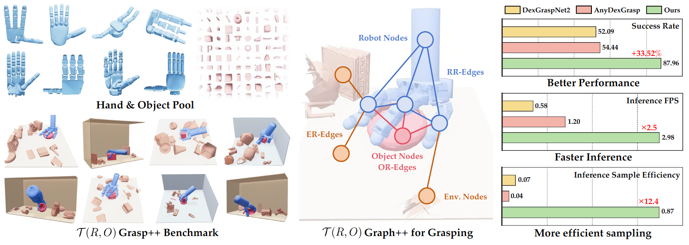

# [CoRL 2026] Official Repo for: T(R,O) Grasp++: Cross-Embodiment Dexterous Grasping in Cluttered Environments at Scale

[Xin Fei](https://xinfei21.github.io/web/)<sup>1,2</sup>, [Zhixuan Xu](https://ariszxxu.github.io/)<sup>1,2</sup>, Huaicong Fang<sup>3</sup>, Fangjun Chen<sup>2,4</sup>, Zhaoyu Mu<sup>1</sup>, Rui Yang<sup>1,2</sup>, [Zhexi Luo](https://zhexiluo.github.io/)<sup>2,5</sup>, [Lin Shao](https://linsats.github.io/)<sup>1,2</sup>

<sup>1</sup>National University of Singapore, <sup>2</sup>RoboScience, <sup>3</sup>Zhejiang University, <sup>4</sup>Southern University of Science and Technology, <sup>5</sup>Sun Yat-sen University


<p align="center">
    <a href='http://arxiv.org/abs/2610.25410'>
      
    </a>
    <a href='https://nus-lins-lab.github.io/TROGrasp2Web/'>
      
    </a>
</p>

<div align="center">
  
</div>

Dexterous grasping in cluttered scenes remains a central challenge in robotic manipulation, as it requires high-dimensional hand coordination under complex object-environment constraints. To address this problem, we introduce one of the largest simulation benchmarks to date, comprising around 0.5B grasp annotations across eight dexterous hands and approximately 50K objects. Furthermore, we propose T(R,O) Grasp++, a scalable diffusion-based framework for cross-embodiment dexterous grasp synthesis in cluttered environments. Extensive experiments demonstrate that our model significantly outperforms existing baselines, achieving an average success rate of 88% across eight dexterous embodiments. Meanwhile, our pipeline achieves only 0.3s inference latency while improving inference sample efficiency by over 10 times.

## Install the main environment

The main code uses Python 3.10 and the `TROV2` Conda environment created by `install.sh`:

```bash
bash install.sh
conda activate TROV2

# Pyroki is needed by grasp inference and visualization.
pip install -e ./third_party/pyroki

# Install the Hugging Face CLI used below to download the dataset.
pip install -U huggingface_hub
```

### Install Isaac Gym for simulation evaluation

The evaluation needs Isaac Gym Preview 4, which uses Python 3.8. Create a separate environment and run `install_isaac.sh` inside it:

```bash
conda create -n TROV2-isaac python=3.8 -y
conda activate TROV2-isaac
bash install_isaac.sh
```

## Download Dataset and Checkpoint

Pretrained checkpoints are included [ckpt](https://drive.google.com/file/d/1mLTmTMilaS5hLyWo5OskxEn9P96CAVko/view?usp=sharing). Download the validation scenes and object assets from [TROV2Dataset](https://huggingface.co/datasets/Barrybarry-Smith/TROV2Dataset) for visualization and inference (`zstd` is required to extract them):

```bash
conda activate TROV2
DATA_ROOT=/mnt/fx/TRO-1B-Dataset
hf download Barrybarry-Smith/TROV2Dataset \
  tar_shards/TRO-val-dataset.tar.zst \
  tar_shards/object_pc.tar.zst \
  tar_shards/object_urdf.tar.zst \
  --repo-type dataset --local-dir "$DATA_ROOT"

for name in TRO-val-dataset object_pc object_urdf; do
  tar -I zstd -xf "$DATA_ROOT/tar_shards/$name.tar.zst" -C "$DATA_ROOT"
done
```

We publish the training data for eight hands: Ability, Allegro, Barrett, DClaw, LEAP, Shadow, Schunk and XHand. For training, download all Zarr shards and extract them into `$DATA_ROOT/object_zarrs` (the full set requires substantial storage):

```bash
hf download Barrybarry-Smith/TROV2Dataset \
  --include 'tar_shards/object_zarrs_*.tar' \
  --repo-type dataset --local-dir "$DATA_ROOT"
mkdir -p "$DATA_ROOT/object_zarrs"
for file in "$DATA_ROOT"/tar_shards/object_zarrs_*.tar; do
  tar -xf "$file" -C "$DATA_ROOT/object_zarrs"
done
```

## Visualize the grasp synthesis

The repository includes XHand predictions in `ckpt/test_meta/test_xhand.pth`. With the validation data and object assets in place, launch the interactive Viser viewer:

```bash
python vis_grasp.py --tro-hand xhand --mode tro-only --port 8091
```

## Run grasp inference

`test.py` generates grasps for validation scenes. Run it by:

```bash
python test.py --config config/val.yaml
```

You can override configuration values on the command line:

```bash
python test.py --config config/val.yaml \
  dataset.hand_type=allegro_hand \
  test.embodiment=allegro_hand \
  test.save_path=./test/allegro_hand.pth
```

Additionally, we provide the checkpoint trained with Wuji Hand in `ckpt/nine_hand_with_wuji.pth`. You can run inference on Wuji Hand by:

```bash
python test.py --config config/val_wuji_hand.yaml
```

## Train

Edit the main settings in `config/train.yaml` before training. `dataset.sources` is a list: you can combine multiple Zarr datasets, each with its own point clouds, hands, and sampling weight.

| Setting | What it controls |
| --- | --- |
| `dataset.sources` | Add one entry per source with a unique `name` and `object_pc_root`. The `original_8_hands` source reads `data_root/object_zarrs`; other sources must set `zarr_root` (and `data_root`). `weight` sets the relative sampling frequency. |
| Source `hand_type`, `dataset.hand_type`, `model.embodiment` | Source hands, dataset hand IDs, and model hands. Selected hands must have the same index in `dataset.hand_type` and `model.embodiment`. |
| `dataset.batch_size`, `dataset.num_workers` | Samples per process and data-loading workers. |
| `vqvae.object_pretrain`, `vqvae.env_pretrain` | Pretrained object and environment encoders in `ckpt/`. |
| `train.lr`, `train.warmup_steps`, `train.total_steps` | Learning rate, warmup, and training length. |
| `train.accumulator`, `train.mixed_precision`, `model.dtype` | Gradient accumulation and precision. |
| `train.save_dir`, `train.save_every`, `train.log_every` | Output directory and checkpoint/log intervals. |
| `train.resume_from`, `train.load_optimizer` | Checkpoint to resume from; set `load_optimizer: true` to restore optimizer and scheduler state. |

For example, append a single-hand dataset to the existing `dataset.sources` list:

```yaml
    - name: extra_xhand
      data_root: /path/to/extra
      zarr_root: /path/to/extra/object_zarrs
      object_pc_root: /path/to/extra/object_pc
      force_hand_type: xhand
      weight: 0.5
```

Launch training with:

```bash
accelerate launch train.py --config config/train.yaml
```

Checkpoints and TensorBoard logs appear in `<train.save_dir>/ckpt/` and `<train.save_dir>/tensorboard/`. If using `train.sh`, first replace its machine-specific acceleration config path.

## Simulation evaluation

Save predictions as `<experiment>/val/<hand>/step_<step>.pth`. Set the data paths, steps, and hands in `validation/convert_before_eval.py`, then prepare simulation inputs:

```bash
conda activate TROV2
python validation/convert_before_eval.py
```

The converter reads `$DATA_ROOT/object_urdf` and writes to `<experiment>/sim/step_<step>/<hand>/`. For the lift test, set the root, steps, hands, and GPUs in `validation/val_lift.py`. Also change its subprocess path from `validation/isaac_main.py` to `validation/validation/isaac_main.py`:

```bash
conda activate TROV2-isaac
python validation/val_lift.py
```

Check collisions with:

```bash
conda activate TROV2
python validation/collision_check.py \
  --sim-root /path/to/experiment/sim \
  --pred-root /path/to/experiment/val \
  --steps step_820000 \
  --robot-names xhand
```

